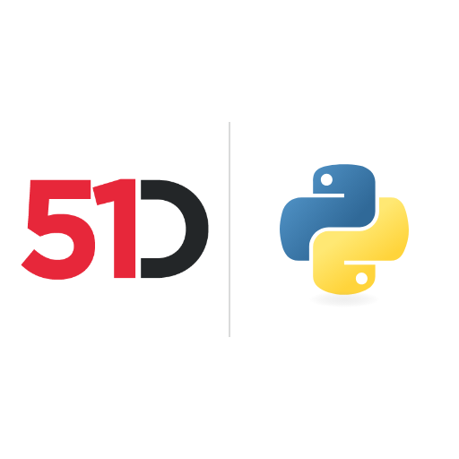

# 51Degrees Device Detection and IP Intelligence for Python



**Python packages for the Pipeline API, Device Detection, IP Intelligence and Location**

Our User-Agent parser for Python supports Device Detection, browser detection, mobile detection, and crawler detection on-premise or in the cloud. IP Intelligence adds IP geolocation, including IP to country data.

It reads User-Agent and User-Agent Client Hints, HTTP request headers that carry browser and device information. For cloud bot detection, Human Confidence reports confidence that a person is viewing the page.

## Install

Device Detection and IP Intelligence, cloud or on-premise, are on PyPI:

```
python -m pip install fiftyone-devicedetection
```

```
python -m pip install fiftyone-ipintelligence
```

The table below lists the other packages. To build from source, see [Getting the code](#getting-the-code).

Try the [User-Agent tester](https://51degrees.com/developers/user-agent-tester?utm_source=github&utm_medium=readme&utm_campaign=51degrees-python&utm_content=readme.md&utm_term=install) and [IP tester](https://51degrees.com/developers/ip-tester?utm_source=github&utm_medium=readme&utm_campaign=51degrees-python&utm_content=readme.md&utm_term=install). For cloud use, [create a Resource Key](https://configure.51degrees.com/?utm_source=github&utm_medium=readme&utm_campaign=51degrees-python&utm_content=readme.md&utm_term=install).

Created from `pipeline-python`, `device-detection-python`, and `location-python`, this repository continues their work.

This repository holds the 51Degrees Python packages. Each product is in its
own folder, which has its own README.

| Product | Folder | PyPI packages |
| --- | --- | --- |
| Pipeline API | [pipeline](pipeline/readme.md) | `fiftyone_pipeline_core`, `_engines`, `_engines_fiftyone`, `_cloudrequestengine`, `_translation`, `_did` |
| Device Detection | [device-detection](device-detection/readme.md) | `fiftyone_devicedetection`, `_shared`, `_cloud`, `_onpremise` |
| IP Intelligence | [ip-intelligence](ip-intelligence/readme.md) | `fiftyone_ipintelligence`, `_shared`, `_cloud`, `_onpremise`, `_translation` |
| Location | [location](location/readme.md) | `fiftyone_location` |

The packages and the order they depend on each other are listed in
[ci/packages.json](ci/packages.json).

## Getting the code

Clone with the submodules:

```
git clone --recurse-submodules https://github.com/51Degrees/51degrees-python.git
```

The data files the examples and tests use are not stored in a repository. The
[data](https://github.com/51Degrees/data) repository, which is the `cxx/data`
submodule, holds a `.link` file for each free one, where the file goes, and
two scripts that download them. From the root of this repository, run

```
sh cxx/data/get-data-files.sh
```

or, in PowerShell,

```
./cxx/data/get-data-files.ps1
```

An example whose file is missing runs the script for that file itself.

Git leaves the folder of a removed submodule on disk. A clone made before the
data files moved to `cxx/data` still has an `ip-intelligence/ip-intelligence-data`
folder, and keeps `cxx/device-detection-data` and `cxx/ip-intelligence-data`
once cxx removes them. Delete those folders, so that nothing finds an old copy
of a data file in them.

Each product's README says what else it needs, such as a C/C++ compiler for
the on-premise engines and the data files.

## Supported Python versions

The packages support Python 3.10 and later. The
[tested versions](https://51degrees.com/documentation/_product_summaries__tested_versions.html?utm_source=github&utm_medium=readme&utm_campaign=51degrees-python&utm_content=readme.md&utm_term=tested-versions)
page lists the versions each release is tested against.

## Versions

Each package has its own version and is released only when it, or a package
it depends on, changes. A release is tagged `<package>/<version>`, for example
`fiftyone_pipeline_core/4.5.39`, and has its own GitHub release.

## History

| Earlier repository | What it held |
| --- | --- |
| [pipeline-python](https://github.com/51Degrees/pipeline-python) | The Pipeline API |
| [device-detection-python](https://github.com/51Degrees/device-detection-python) | Device Detection |
| [location-python](https://github.com/51Degrees/location-python) | Location |

This repository brings together those repositories and the IP Intelligence
packages, each in a folder named without the language: `pipeline`,
`device-detection`, `location` and `ip-intelligence`. Their full history is included, with every commit keeping its original
SHA, so `git log --follow` traces a file back through the move. The tags and
releases of the original repositories stay with those repositories.

## License

[European Union Public Licence v1.2](LICENSE), with the additional terms in
[NOTICE](NOTICE), which every source file also states. Every package declares
EUPL-1.2.

## Find out more

- [Device Detection](https://51degrees.com/device-detection?utm_source=github&utm_medium=readme&utm_campaign=51degrees-python&utm_content=readme.md&utm_term=find-out-more)
- [IP Intelligence](https://51degrees.com/ip-intelligence?utm_source=github&utm_medium=readme&utm_campaign=51degrees-python&utm_content=readme.md&utm_term=find-out-more)
- [Bots and humans](https://51degrees.com/bots-and-humans?utm_source=github&utm_medium=readme&utm_campaign=51degrees-python&utm_content=readme.md&utm_term=find-out-more)
- [Documentation](https://51degrees.com/documentation/index.html?utm_source=github&utm_medium=readme&utm_campaign=51degrees-python&utm_content=readme.md&utm_term=find-out-more)
- https://github.com/51Degrees/51degrees-cxx
