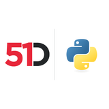

# 51Degrees Device Detection Engines - Examples

 **v4 Device Detection Python**

[Developer Documentation](https://51degrees.com/documentation/_device_detection__quickstart.html?utm_source=github&utm_medium=readme&utm_campaign=51degrees-python&utm_content=fiftyone_devicedetection_examples-readme.md&utm_term=51degrees-device-detection-engines-examples "Developer Documentation") | [Available Properties](https://51degrees.com/resources/property-dictionary?utm_source=github&utm_medium=readme&utm_campaign=51degrees-python&utm_content=fiftyone_devicedetection_examples-readme.md&utm_term=51degrees-device-detection-engines-examples "View all available properties and values")

## Introduction

This project contains examples for the 51Degrees device detection engines contained in this repository.
Then you will be able to run the examples directly:

## Examples

Any of the examples in this project can be run by calling python directly. For example, to run the cloud
getting started example:

`python -m fiftyone_devicedetection_examples.cloud.gettingstarted_console`

## Tests

To run the tests use:

`python -m unittest discover -s tests -p test*.py -b`

Cloud tests will only run with a valid 51Degrees resource key (see above) set as a resource_key operating system environment variable.

For example, use following command to set resource_key on Linux:
`export resource_key=MY-RESOURCE-KEY`

On Microsoft Windows use:
`$env:resource_key = "MY-RESOURCE-KEY"`

As the performance and offline processing tests take longer than the others, there is another environment variable flag to run those:

Linux:
`export run_performance_tests=true`

Microsoft Windows:
`$env:run_performance_tests = "true"`
